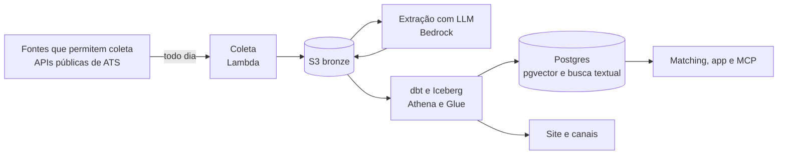

# Liberty Find

[](https://github.com/FernandoCCristovao/liberty-find/actions/workflows/ci.yml)

**Vagas que dão liberdade: de lugar, de dinheiro e de tempo.** O Liberty Find está sendo construído
para reunir vagas de fontes que permitem coleta, extrair com IA os sinais que importam para quem quer
trabalhar de onde quiser (de quais países se pode trabalhar, salário e moeda, inglês exigido, carga e
flexibilidade), mostrar a frase da vaga que sustenta cada sinal e explicar o encaixe com o que cada
pessoa procura.

> **Estado:** fundação. Hoje funciona a coleta do Greenhouse de ponta a ponta, com testes, rodando
> localmente; o resto está planejado marco a marco ([docs/marcos/](docs/marcos/README.md)). O canal
> público é o Marco 3; os links entram aqui quando estiverem no ar.

## O que ele vai fazer

| Marco | Entrega | Estado |
| --- | --- | --- |
| 1 | Coleta diária de quatro fontes, infraestrutura em Terraform e sinais extraídos por um modelo escolhido por avaliação | em andamento |
| 2 | Lakehouse com dbt e Iceberg, deduplicação, vagas fechadas, orquestração e insights do mercado | planejado |
| 3 | Canal público: site, Telegram e newsletter com vagas verificadas, sem login | planejado |
| 4 | Matching pessoal com busca híbrida, explicação e servidor MCP | planejado |
| 5 | App beta com login, alertas por e-mail e feedback | planejado |
| 6 | Assistente que ajuda a preparar a candidatura, com a pessoa no comando | planejado |

## Arquitetura (desenho alvo)



Desenho completo, stack e custos em [docs/arquitetura.md](docs/arquitetura.md); o porquê de cada
escolha em [docs/decisoes/](docs/decisoes/README.md).

## Como rodar

Pré-requisito: [uv](https://docs.astral.sh/uv/) (ele instala o Python 3.12).

```bash
uv sync                                       # dependências
uv run poe check                              # lint, tipos, testes e template
uv run liberty boards                         # empresas acompanhadas
uv run liberty probe greenhouse quintoandar   # testa uma empresa na API real
uv run liberty collect --local                # coleta tudo e grava em ./data
```

Publicar na AWS e operar: [docs/operacao.md](docs/operacao.md).

## Dados e conformidade

- **Fontes:** só fontes cujos termos permitem coleta, classificadas por nível de permissão, sempre
  com atribuição e link para a vaga original. LinkedIn, Indeed, Glassdoor e portais que proíbem
  coleta ficam de fora ([docs/dados/fontes.md](docs/dados/fontes.md)).
- **O que será publicado:** campos derivados, um resumo próprio, trechos curtos de evidência dentro
  da política de cada fonte e o link para a vaga original. A descrição completa fica privada.
- **Pessoas:** quando houver contas, só o necessário para buscar, nada sensível e apagar pelo próprio
  app ([docs/privacidade.md](docs/privacidade.md)).
- **Cobertura:** só empresas presentes nessas fontes. Os números descrevem esse recorte.

## Custo e proteções

Serverless, com custo esperado de poucos dólares por mês. Já no template de hoje: limite de leitura
por consulta no Athena, expiração dos dados brutos e dos resultados de consulta e alarme quando a
coleta falha. Planejado: teto de extrações por execução e orçamento com alerta como código. Regra
desde já: nada com custo fixo sem ADR.

## Estrutura

```text
src/liberty_find/   coleta, fontes, contratos, extração e CLI
tests/              testes sem rede (fixtures sintéticas)
template.yaml       infraestrutura (AWS SAM) até a migração para Terraform
docs/               produto, arquitetura, dados, privacidade, decisões e marcos
AGENTS.md           guia para agentes de IA que trabalham no repositório
```

## Licença

[FSL-1.1-ALv2](LICENSE), uma licença fair source: você pode ler, rodar, modificar e usar o código
internamente, para estudo ou pesquisa; não pode oferecê-lo como produto ou serviço concorrente.
Cada versão passa a valer também sob a Apache 2.0 dois anos depois de publicada. A marca Liberty
Find não está incluída na licença.

## English summary

Liberty Find is a job-discovery platform being built for Portuguese speakers in Brazil and Portugal.
The plan: collect postings only from sources that allow it (public ATS APIs), use LLMs to extract
"freedom signals" (remote eligibility by country, salary and currency, required English level,
workload and flexibility) together with the sentence that supports each one, and rank postings
against each user's search profile. Target stack: serverless on AWS (Lambda, S3, Athena, Iceberg,
dbt, Bedrock, Step Functions), Postgres with pgvector for hybrid search, and Terraform. Today: the
Greenhouse collector works end to end with tests, and the infrastructure is still an AWS SAM
template. Documentation is in Portuguese; code is in English. License: FSL-1.1-ALv2 (fair source).
