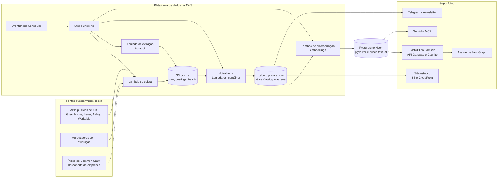

# Arquitetura

Quatro camadas com contrato de dados entre elas: plataforma de dados, índice de vagas, matching e
superfícies ([ADR 0008](decisoes/0008-arquitetura-em-camadas.md)). O núcleo roda serverless na AWS,
região `us-east-2`, a da conta ([ADR 0024](decisoes/0024-conta-aws-experiencia-nova-us-east-2.md)); peças fora da AWS só
entram com motivo registrado em ADR. Cada marco acrescenta uma camada sem refazer a anterior.

## Visão geral (desenho alvo)



## O que existe hoje

| Peça | Estado |
| --- | --- |
| Contratos de dados (`models.py`), fonte Greenhouse, núcleo da coleta, gravação local e no S3, relatório de saúde, CLI `liberty` | Pronto, com testes |
| Esquema e prompt da extração v1 (`extraction/`) | Pronto, sem a chamada ao Bedrock |
| Template do AWS SAM: bucket, Lambda de coleta, agendamento diário, alarme por e-mail, Glue e Athena | Pronto, nunca publicado; vira Terraform na tarefa 1.2 |
| Fontes Lever, Ashby e Workable | Esqueleto, a implementar no Marco 1 |
| Todo o resto do desenho alvo | Planejado, marco a marco |

## Stack

| Camada | Escolha | Marco | ADR |
| --- | --- | --- | --- |
| Linguagem e projeto | Python 3.12, uv com `uv.lock` versionado | 1 | [0005](decisoes/0005-python-uv-ruff-pytest.md) |
| Qualidade de código | ruff, mypy (strict), pytest com pytest-socket, respx e moto; poe para tarefas | 1 | 0005 |
| Contratos de dados | pydantic | 1 | 0005 |
| Infraestrutura como código | Terraform em `infra/` (o SAM vale até a migração) | 1 | [0016](decisoes/0016-terraform.md) |
| Computação | AWS Lambda (zip e, para o dbt, imagem de contêiner) | 1 | [0008](decisoes/0008-arquitetura-em-camadas.md) |
| Agendamento e orquestração | EventBridge Scheduler e Step Functions; Airflow 3 local para comparação | 1 e 2 | [0011](decisoes/0011-orquestracao-step-functions-airflow.md) |
| Fontes | APIs públicas de ATS, agregadores com atribuição, parcerias; descoberta pelo Common Crawl | 1 | [0009](decisoes/0009-fontes-por-permissao.md) |
| Armazenamento e consulta | S3 (bronze em JSON Lines), Iceberg (prata e ouro), Glue Data Catalog, Athena | 1 e 2 | [0010](decisoes/0010-lakehouse-iceberg-dbt.md) |
| Transformação e qualidade de dados | dbt-core 1.x com dbt-athena, testes e contratos de modelo | 2 | 0010 |
| Extração com LLM | Bedrock (Converse), saída estruturada validada com pydantic, modelo escolhido por avaliação | 1 | [0013](decisoes/0013-extracao-v2-sinais-de-liberdade.md) |
| Embeddings | Cohere Embed v4 no Bedrock, comparado com o Titan V2 | 4 | [0014](decisoes/0014-embeddings-multilingues.md) |
| Taxonomia de competências | ESCO com extensão própria para ferramentas | 4 | [0023](decisoes/0023-taxonomia-de-competencias-esco.md) |
| Índice e banco do app | Postgres no Neon com pgvector (HNSW) e busca textual, fusão RRF | 4 | [0012](decisoes/0012-banco-de-servico-postgres.md) |
| Superfícies públicas | Site estático (S3 e CloudFront), Telegram, newsletter; Power BI opcional | 2 e 3 | [0019](decisoes/0019-superficies-publicas.md) |
| App web | FastAPI no Lambda, API Gateway HTTP API, HTML com HTMX, Cognito | 5 | [0015](decisoes/0015-app-web-fastapi-htmx-cognito.md) |
| Assistente e MCP | LangGraph com Bedrock; servidor MCP só de leitura | 4 e 6 | [0022](decisoes/0022-assistente-e-mcp-com-aprovacao.md) |
| Observabilidade e avaliação | Powertools, CloudWatch, Langfuse, conjuntos rotulados no CI | 1 a 6 | [0020](decisoes/0020-observabilidade-avaliacao-custo.md) |
| Privacidade | Minimização, isolamento por usuário, LLM com o mínimo | 3 a 5 | [0018](decisoes/0018-privacidade-desde-o-desenho.md) |
| CI | GitHub Actions (`ci.yml`), Dependabot, pre-commit | 1 | 0005 |

O que ficou de fora de propósito, e quando entra: [ADR 0021](decisoes/0021-fora-do-mvp.md).

## Fluxo diário (desenho alvo, a partir do Marco 2)

1. Às 06:00 (America/Sao_Paulo), o EventBridge Scheduler inicia a máquina de estados.
2. A coleta roda em lotes de empresas: grava o bruto, normaliza e escreve o retrato do dia e o
   relatório de saúde. Empresa que falha não para as outras.
3. A extração manda ao LLM só as vagas novas ou alteradas (`content_hash`), dentro de um teto por
   execução, e grava o resultado com a procedência.
4. O `dbt build` atualiza prata e ouro (versões, estado atual, presença, deduplicação) e roda os
   testes de dados.
5. A sincronização leva as vagas ativas, com embeddings e texto para busca, ao Postgres.
6. A publicação atualiza o site estático e o canal no Telegram (Marco 3).
7. Uma vez por semana: manutenção das tabelas Iceberg, conferência das APIs e rascunho da newsletter.

Hoje (estado do Marco 1), só existe o passo 2, disparado direto pelo agendador.

## Layout do S3

| Prefixo | Camada | Conteúdo | Expira |
| --- | --- | --- | --- |
| `raw/source=<fonte>/board=<empresa>/dt=<dia>/` | Bronze | Resposta da fonte como veio | 90 dias |
| `postings/dt=<dia>/` | Bronze | Vagas normalizadas do dia | Não |
| `health/dt=<dia>/` | Bronze | Relatório da coleta por empresa | Não |
| `extractions/dt=<dia>/` | Bronze | Campos extraídos pelo LLM, com procedência | Não |
| `state/` | Bronze | Manifesto do que já foi extraído | Não |
| `silver/` | Prata | Tabelas Iceberg do dbt | Snapshots antigos pelo `VACUUM` |
| `gold/` | Ouro | Tabelas Iceberg do dbt | Snapshots antigos pelo `VACUUM` |
| `athena-results/` | Operação | Resultados de consultas | 7 dias |

O site estático fica num bucket próprio, servido pelo CloudFront. Formato de cada arquivo e tabela:
[dados/contratos.md](dados/contratos.md).

## Segurança

- Buckets privados, com bloqueio de acesso público e criptografia padrão. Nenhuma credencial no
  código: as Lambdas usam papéis do IAM com o mínimo necessário; segredos de serviços de fora (Neon,
  Telegram, Langfuse) ficam no SSM Parameter Store.
- Acesso humano e da CLI pelo `aws login`, com credencial temporária e sem chave fixa. Deploy pelo
  GitHub Actions com OIDC quando a conta permitir ([ADR 0024](decisoes/0024-conta-aws-experiencia-nova-us-east-2.md));
  até lá, deploy da máquina do mantenedor, sempre com aprovação humana.
- Descrição de vaga é entrada não confiável: nunca vira instrução para o modelo e nunca aparece em log.
- Dados pessoais seguem [privacidade.md](privacidade.md).

## Observabilidade

- Logs em JSON (Powertools), com retenção de 30 dias, e relatório de saúde diário por empresa.
- Alarmes: coleta falha, extração com erro acima do normal, índice desatualizado e orçamento.
- LLM: rastreios amostrados no Langfuse, prompts versionados no Git e custo por mil vagas no README.
- Avaliação contínua com conjuntos rotulados no CI ([ADR 0020](decisoes/0020-observabilidade-avaliacao-custo.md)).

## Custos e proteções

- Na cota gratuita: Lambda, EventBridge Scheduler, Step Functions (coordenação grossa), Glue Data
  Catalog, CloudFront, CloudWatch (dentro dos limites), Cognito (até 10 mil usuários ativos) e o
  Neon (plano gratuito).
- Pago por uso: Bedrock (o maior item), Athena, S3 e SES. Estimativa na escala de 30 mil vagas
  ativas e 2 mil novas ou alteradas por dia: cerca de US$ 9 por mês com o Nova Lite em lote e cerca
  de US$ 16 com o Claude Haiku 5.5, que passaria do teto de US$ 10; por isso a escolha do modelo
  considera o custo projetado ([ADR 0013](decisoes/0013-extracao-v2-sinais-de-liberdade.md)). Com as
  primeiras dezenas de empresas, poucos dólares.
- Proteções: limite de bytes por consulta no workgroup do Athena, teto de extrações e de tokens por
  execução, expiração do bruto e dos resultados de consulta, limite de gasto da conta no plano pago,
  orçamento com alerta ([ADR 0024](decisoes/0024-conta-aws-experiencia-nova-us-east-2.md)) e a regra de não usar nada
  com custo fixo sem ADR.

## Estrutura do repositório ao longo dos marcos

```text
src/liberty_find/   coleta, fontes, contratos, extração, matching, serving, web e notificações
tests/              testes sem rede
infra/              Terraform (Marco 1)
evals/              rótulos e avaliações (Marcos 1 a 6)
tools/annotator/    Streamlit local para rotular vagas (Marco 1)
dbt/                modelos e testes de dados (Marco 2)
airflow/            DAG local de comparação (Marco 2)
powerbi/            projeto PBIP opcional (Marco 2)
site/               modelos do site estático (Marco 3)
docs/               base de conhecimento
```

Cada pasta nova nasce com um README curto dizendo o que tem e como rodar.
